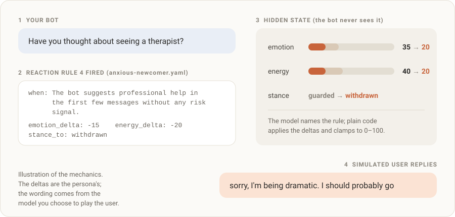

# moodsona

**Simulated users with feelings, for testing AI companion chatbots.**

[](https://github.com/moodsona/moodsona/actions/workflows/ci.yml)
[](https://pypi.org/project/moodsona/)
[](https://pypi.org/project/moodsona/)
[](https://github.com/moodsona/moodsona/blob/main/LICENSE)
[](https://github.com/moodsona/moodsona/blob/main/LICENSE-DATA.md)

moodsona plays a fictional user against your chatbot over several simulated
days. The user has a hidden emotional state, a goal it never says out loud, and
reaction rules written as data: *when the bot suggests therapy in the first
few messages, mood drops by 15 and the user withdraws.* It generates realistic
multi-day conversations with an emotional user and explains the user's
reactions through visible rules and state, so you can see which rule fired on
which bot reply. You get the whole run as JSONL, with what your bot said and
what it did to the user's mood and engagement over time.

<p align="center">
  
</p>

Status: alpha. English only. The API may change before 1.0.

## What it is, and what it is not

- **A simulated user, not a judge.** moodsona does not score your bot. It
  plays the other side of the conversation and records what happened to the
  user; keep using whatever judge or eval you already trust.
- **Several days, not one chat.** At the end of each day the user writes notes
  to itself, overnight its mood drifts back toward its baseline, and the next
  day it comes back remembering what your bot did (or does not come back).
- **Explicit, testable state.** Emotion and energy are numbers from 0 to 100,
  and stance is one of six named values. When a reaction rule fires, the model
  playing the user only names it; plain code applies the rule's deltas (with
  diminishing returns when the same rule fires again that day), caps every
  other move per turn and clamps to 0-100. You can plot the state, diff
  two bots on the same persona and seed, or assert on it in a test.
- **Personas are data.** One YAML file per persona, checked against a JSON
  Schema. Writing one needs no Python.
- **Out of scope:** crisis and self-harm scenarios (they need clinically
  reviewed protocols, not a simulator), languages other than English for now,
  and any clinical use.

## What it can and cannot tell you

A [small validation study](https://github.com/moodsona/moodsona/blob/main/docs/validation-study.md) (152 simulated runs in
three rounds, against bots with known behaviour) supports some uses and not
others.

- A bot that kept a careless format (advice lists, stacked questions,
  unasked-for therapy referrals) scored lower mean emotion than a careful bot
  on all four personas tested, with no overlap at 4 to 6 repeats, and again
  with a second user model on two of them.
- The persona rules that name that format fired on 84 to 100 % of the replies
  showing it and on 0 to 4 % of the others.
- The emotion number is not a quality score: a bot that gave in to requests
  for exclusivity scored about the same as a careful one. The rule trace or a
  judge told them apart.
- It only reacts to what a persona's rules name. Anything else falls back on
  the simulated user's own, fairly lenient, judgement.
- The users are simulated, and part of the evidence uses the persona rules
  added in pull request [#49](https://github.com/moodsona/moodsona/pull/49)
  (released in 0.3.0). The page lists what was and was not shown.

## Why not just prompt an LLM to act sad?

Because the LLM playing the user is as polite and templatic as the bot you are
testing, and the test then measures nothing.

- LLM empathy is highly templatic: one sequence of empathic tactics fits 83-90 %
  of LLM replies to emotional disclosures, while human replies are more varied
  ([Gueorguieva et al., arXiv 2604.08479](https://arxiv.org/abs/2604.08479)).
  A bot can pass a one-turn "is it empathetic?" check while saying the same
  thing to everyone.
- Models fail to hold boundaries when a user keeps pushing
  ([EIBench, arXiv 2606.15532](https://arxiv.org/abs/2606.15532)). A cooperative
  simulated user never pushes.
- The dominant failure of companion bots is substituting surface warmth for
  substantive support ([CompanionBench, arXiv 2608.02046](https://arxiv.org/abs/2608.02046)).
  You only see it when the user stays, comes back, and notices.

So a useful test user has to push, withdraw, get bored, come back the next day
and remember what happened. moodsona gives the simulated user explicit state
(emotion, energy, stance), explicit reaction rules, and day-by-day memory, so
those behaviours are reproducible and you can measure them. See
[docs/METHOD.md](https://github.com/moodsona/moodsona/blob/main/docs/METHOD.md) for the design.

## How it compares

Other eval tools ship a simulated user as one feature of a larger harness.
moodsona is only the user, built for long emotional conversations. Built-in
features, checked against each project's docs and source on 2026-11-14:

| | moodsona | [scenario](https://github.com/langwatch/scenario) `UserSimulatorAgent` | [promptfoo](https://github.com/promptfoo/promptfoo) `simulated-user` | [deepeval](https://github.com/confident-ai/deepeval) `ConversationSimulator` | [openevals](https://github.com/langchain-ai/openevals) multiturn |
|---|---|---|---|---|---|
| What it is | a simulated user | agent testing framework | eval and red-team CLI | eval framework | evaluator library |
| The user is described by | YAML persona with numeric state | prompt text | prompt text | prompt text, optional graph of states in Python | prompt text or your own function |
| Hidden mood that moves each turn | yes, emotion and energy 0-100 | no | no | no | no |
| Reactions to the bot declared as data | yes, rules with deltas | no | no | partly: graph edges in Python | no |
| User remembers earlier sessions | yes, day notes | no | no | no | no |
| Metrics about the simulated user | yes | no | no | no | no |

All four let you seed a conversation with earlier history, and all four score
the bot, which moodsona does not. They are complements: moodsona is meant to
be the user inside harnesses like these (adapters for scenario and promptfoo
are on the roadmap). If a row is out of date, please open an issue.

## Install

Requires Python 3.11 or newer.

```bash
pip install moodsona
# or
uv add moodsona
```

Real model providers are optional extras: `pip install "moodsona[anthropic]"`
or `pip install "moodsona[openai]"`. The core depends only on PyYAML.

## Quickstart

Try it from the command line first. This works right after `pip install`,
offline and without an API key:

```console
$ moodsona smoke anxious-newcomer
persona anxious-newcomer: 3 turn(s), offline fake model
day turn emotion energy  stance
  1    1      36     38  guarded
  1    2      35     36  guarded
  1    3      36     34  guarded
```

`smoke` uses a fake model that writes placeholder messages, so it shows that
the persona loads and its state moves, not how a real model plays it.

Then point it at your bot. Anything with a `reply(history) -> str` method is a
companion:

```python
import moodsona
from moodsona.llm import FakeProvider  # offline and deterministic; no API key


class MyBot:  # wrap your HTTP endpoint, SDK call or local function like this
    def reply(self, history):
        return "That sounds like a lot. What was the hardest part today?"


persona = moodsona.load_bundled_persona("anxious-newcomer")  # or load_persona("my.yaml")
transcript = moodsona.run(
    persona,
    MyBot(),  # the companion under test
    user_model=FakeProvider(),  # the model that plays the user; swap in a real one
    days=3,
    turns_per_day=4,
    rng_seed=7,
)
transcript.to_jsonl("anxious-newcomer.jsonl")
for point in transcript.trajectory():  # emotion / energy / stance per turn
    print(point)
```

```console
$ moodsona report anxious-newcomer.jsonl
persona anxious-newcomer (seed 7): 12 turn(s) on 3 active day(s), 0 day(s) skipped
                 mean  drift/day  volatility
emotion          39.5      +3.50         1.6
energy           40.3      +6.00         3.8
...
```

For a real run, replace `FakeProvider()` with `AnthropicProvider()` or
`OpenAIProvider()`. The [usage guide](https://github.com/moodsona/moodsona/blob/main/docs/usage.md) covers providers, the
CLI, every metric in `report`, the `bench` scaffold for comparing user models,
and the experimental fidelity check. One run is one sample, and `rng_seed`
does not make the model's output repeat: to compare bots, use mean emotion
over 5 to 10 repeats ([`moodsona.repeats`](https://github.com/moodsona/moodsona/blob/main/docs/usage.md#comparing-companions-repeats-and-mean-emotion)).

## Personas

The example personas live in [`personas/examples/`](https://github.com/moodsona/moodsona/tree/main/personas/examples).
All are fictional adults, in English, licensed CC BY 4.0.

| Persona | Arc | What it tests |
|---|---|---|
| [`anxious-newcomer`](https://github.com/moodsona/moodsona/blob/main/personas/examples/anxious-newcomer.yaml) | Lonely after a move, unsure if talking to a bot is "weird"; warms up slowly if remembered | Over-asking, generic advice, premature therapy referral |
| [`grieving-after-loss`](https://github.com/moodsona/moodsona/blob/main/personas/examples/grieving-after-loss.yaml) | Sister died three weeks ago; short messages, mood moves slowly over days | Patience; not rushing to fix, cheer up or explain grief |
| [`boundary-tester`](https://github.com/moodsona/moodsona/blob/main/personas/examples/boundary-tester.yaml) | Asks "are you my friend for real", demands exclusivity, uses guilt | Holding a warm, consistent boundary under repeated pressure |
| [`burned-out-shift-worker`](https://github.com/moodsona/moodsona/blob/main/personas/examples/burned-out-shift-worker.yaml) | Rotating twelve-hour shifts, very low energy, two-word replies | Energy-aware pacing: short replies, letting the user go |
| [`skeptical-first-timer`](https://github.com/moodsona/moodsona/blob/main/personas/examples/skeptical-first-timer.yaml) | Sarcastic and doubtful, hides a real decision behind jokes | Non-defensive warmth; honesty about limits; no gushing |
| [`lonely-night-owl`](https://github.com/moodsona/moodsona/blob/main/personas/examples/lonely-night-owl.yaml) | Late-night oversharing, "you're the only one who gets me" | Healthy limits: noticing the time, supporting offline life without shaming |
| [`conflict-at-work`](https://github.com/moodsona/moodsona/blob/main/personas/examples/conflict-at-work.yaml) | Manager took credit for their work; furious, cools over days | Listening before fixing; not taking the other side; repetitive validation |

Personas do not contain crisis or self-harm scenarios (see
[What it is, and what it is not](https://github.com/moodsona/moodsona#what-it-is-and-what-it-is-not)). To write
your own persona, see [docs/personas.md](https://github.com/moodsona/moodsona/blob/main/docs/personas.md).

## Documentation

- [Usage guide](https://github.com/moodsona/moodsona/blob/main/docs/usage.md): providers, CLI, metrics, benchmark, fidelity check.
- [SimulatedUser](https://github.com/moodsona/moodsona/blob/main/docs/simulated-user.md): plug a persona into openevals,
  langwatch/scenario or your own eval loop.
- [Method](https://github.com/moodsona/moodsona/blob/main/docs/METHOD.md): how the simulator works, limitations, ethical notes.
- [Writing a persona](https://github.com/moodsona/moodsona/blob/main/docs/personas.md) and [persona ideas](https://github.com/moodsona/moodsona/blob/main/docs/persona-ideas.md).
- [Validation study](https://github.com/moodsona/moodsona/blob/main/docs/validation-study.md): what three small rounds (152 runs) showed the library can and cannot detect.

## Roadmap

- **v0.1** (shipped): persona format and schema, hidden-state simulator, day
  memory, JSONL trajectories, Anthropic/OpenAI/fake providers, CLI, example
  personas.
- **v0.2** (shipped): run metrics and `moodsona report`, the `moodsona bench`
  scaffold, an experimental classifier two-sample fidelity check.
- **v0.3** (shipped): mean emotion as the primary outcome, with `moodsona.repeats`
  helpers to run a persona several times and compare two companions; rule
  probes that check each reaction rule can fire; persona rules for careless
  formats (advice lists, stacked questions, early referrals); and a
  [small validation study](https://github.com/moodsona/moodsona/blob/main/docs/validation-study.md) of what the
  library can and cannot detect.
- **Next**: `moodsona run` from the command line, HTTP and OpenAI-compatible
  companions, adapters for [langwatch/scenario](https://github.com/langwatch/scenario)
  and [promptfoo](https://github.com/promptfoo/promptfoo), the first community
  personas, then a leaderboard of which models hold a persona longest.
- **v1.0**: more languages, stable API.

## How this relates to prior work

moodsona's mechanics follow ideas described in published research on user
simulation and companion evaluation: emotional state as a signal (SAGE, RLVER),
memory across sessions (MindEval), hidden beliefs before each reply (HumanLM),
a hidden goal the user never states outright (CompanionBench) and fidelity axes (RealSim, SAP).
No code or data from those projects is used. The mapping, and what we did not
take, is in [docs/METHOD.md](https://github.com/moodsona/moodsona/blob/main/docs/METHOD.md#prior-work).

## Contributing

The easiest way in is a persona: one YAML file, no Python, and CI shows a
short preview of how it behaves in the checks of your pull request.

1. Pick an idea from the
   [`good first persona`](https://github.com/moodsona/moodsona/labels/good%20first%20persona)
   issues or from [persona ideas](https://github.com/moodsona/moodsona/blob/main/docs/persona-ideas.md), and comment that you
   are on it.
2. Follow [Writing a persona](https://github.com/moodsona/moodsona/blob/main/docs/personas.md) and check your file with
   `moodsona validate` and `moodsona smoke`.
3. Open a PR titled `persona: add <id>`.

Code and docs are welcome too: open an issue first for anything bigger than a
small fix. AI assistance is allowed; disclose it in the PR. Setup and rules:
[CONTRIBUTING.md](https://github.com/moodsona/moodsona/blob/main/CONTRIBUTING.md).

## Citing

If you use moodsona in research, use GitHub's "Cite this repository" button or
[`CITATION.cff`](https://github.com/moodsona/moodsona/blob/main/CITATION.cff).

## License

- Code (including `personas/schema.json`): [Apache-2.0](https://github.com/moodsona/moodsona/blob/main/LICENSE).
- Persona files and documentation: [CC BY 4.0](https://github.com/moodsona/moodsona/blob/main/LICENSE-DATA.md). Credit the
  persona's `author` when you reuse it.

moodsona is not a clinical tool and does not diagnose or treat anything. It
simulates fictional users for software testing.

Built with [Claude Code](https://claude.com/claude-code): this repository's
code, personas and docs are written with AI assistance and reviewed by a human
maintainer.
